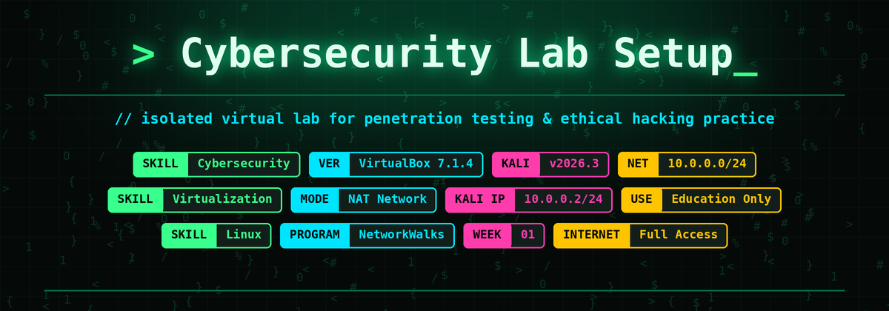
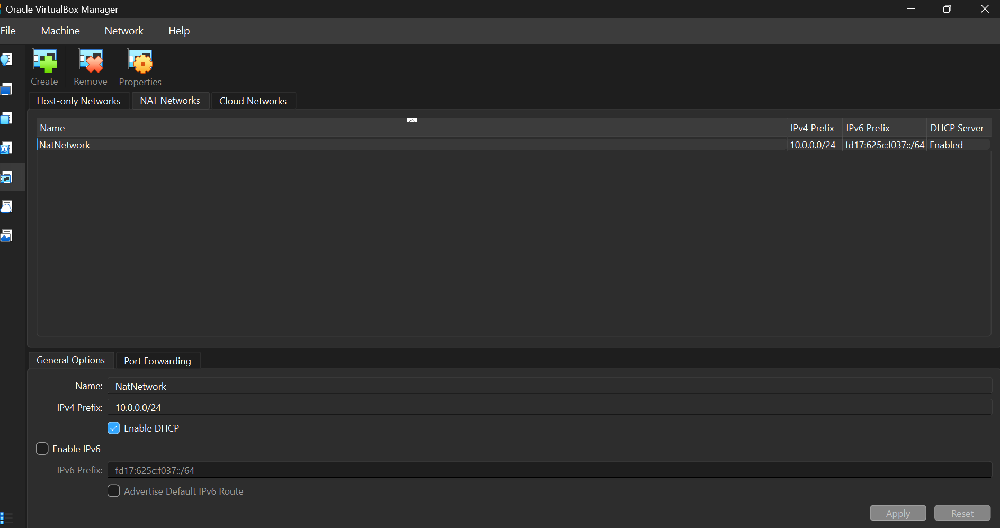

# Cybersecurity-at-Networkwalks-Week-01-Project-
<p align="center">
  
</p>

---

## 📌 Project Overview

This project documents the setup of a **virtual cybersecurity and penetration-testing laboratory** using **Oracle VirtualBox** as the hypervisor and **Kali Linux** as the attacker machine.

The lab runs on a private **NAT Network (10.0.0.0/24)**, giving a controlled, repeatable environment where additional target machines can be added later for authorized security testing.

> **Program:** Cybersecurity at Networkwalks | **Week:** 01 | **Project:** Cybersecurity & Pentesting Lab Setup

---

## 🎯 Project Objectives and Status

| # | Requirement | Status |
|---|-------------|:------:|
| 1 | Use VirtualBox as the base hypervisor (latest version) | ✅ |
| 2 | Set up Kali Linux as the attacking machine (latest version, as a VM) | ✅ |
| 3 | Use a **NAT Network** with the **10.0.0.0/24** subnet | ✅ |
| 4 | Enable **clipboard** and **drag & drop** in the VM settings | ✅ |
| 5 | Enable a **shared folder** with the host `/downloads` folder | ✅ |
| 6 | Kali Linux IP address set to **10.0.0.2/24** | ✅ |
| 7 | Kali Linux has **full Internet access** | ✅ |

---

## 🛡️ Purpose of the Lab

The lab provides an isolated environment for cybersecurity learning and authorized testing, such as:

- Network reconnaissance and port scanning
- Vulnerability assessment
- Packet analysis
- Web security testing
- Security-tool experimentation

⚠️ **Important:** Use this lab only on systems you own or have explicit permission to test.

---

## ⚙️ Lab Configuration

| Component | Configuration |
|-----------|---------------|
| Host OS | Windows 11 |
| Hypervisor | Oracle VirtualBox 7.1.4 |
| Attacker OS | Kali Linux 2026.3 (`kali-linux-2026.3-virtualbox-amd64`) |
| Kali RAM / CPUs | 2048 MB / 2 |
| Kali Disk | 80.09 GB (VDI) |
| Virtual Network | NAT Network – `NatNetwork` |
| Network Address | 10.0.0.0/24 (DHCP enabled, IPv6 disabled) |
| Adapter Type | Intel PRO/1000 MT Desktop |
| Promiscuous Mode | Allow All |
| Kali IP Address | **10.0.0.2/24** (manual) |
| Default Gateway | 10.0.0.1 |
| DNS Server | 10.0.0.1 |

---

## 🪜 Lab Setup Procedure

### Step 1. Install VirtualBox

Oracle VirtualBox was downloaded from the official site and installed on the Windows 11 host.


---

### Step 2. Import Kali Linux as a Virtual Machine

The pre-built Kali Linux VirtualBox image was downloaded from the official Kali website and imported into VirtualBox.


---

### Step 3. Create the NAT Network (10.0.0.0/24)

Opened **File → Tools → Network → NAT Networks** and created a network with these settings:

```
Name:        NatNetwork
IPv4 Prefix: 10.0.0.0/24
DHCP:        Enabled
IPv6:        Disabled
```




A **NAT Network** was chosen so that multiple VMs on the same network can communicate with each other while still having outbound Internet access through NAT.

---

### Step 4. Attach Kali to the NAT Network

In the Kali VM **Settings → Network → Adapter 1**:

```
Attached to:      NAT Network
Name:             NatNetwork
Adapter Type:     Intel PRO/1000 MT Desktop (82540EM)
Promiscuous Mode: Allow All
Cable Connected:  Yes
```


---

### Step 5. Enable Clipboard & Drag and Drop

In the Kali VM **Settings → General → Advanced**:

```
Shared Clipboard: Bidirectional
Drag'n'Drop:      Bidirectional
```

<!-- TODO: add a screenshot, upload it as clipboard_dragdrop.png, then remove the comment markers around the line below

-->

---

### Step 6. Configure the Shared Folder (`/downloads`)

In the Kali VM **Settings → Shared Folders**, the host Downloads folder was added:

```
Folder Path:    <host>\Downloads
Folder Name:    downloads
Mount point:    /downloads
Auto-mount:     Enabled
Make Permanent: Enabled
```

<!-- TODO: add a screenshot, upload it as shared_folder.png, then remove the comment markers around the line below

-->

---

### Step 7. Assign the Static IP Address 10.0.0.2/24 to Kali

Kali was first booted on the NAT Network.


Using **Advanced Network Configuration** (`nm-connection-editor`), the wired connection's **IPv4 Settings** were changed to Method: **Manual**:

```
Address:  10.0.0.2
Netmask:  24
Gateway:  10.0.0.1
DNS:      10.0.0.1
```


The connection was then restarted from the terminal to apply the settings:

```bash
sudo nmcli connection modify "Wired connection 1" ipv4.dad-timeout 0
sudo nmcli connection down "Wired connection 1"
sudo nmcli connection up "Wired connection 1"
```


---

## 🔎 Verification

### Internet connectivity

After applying the static IP, Kali reached the Internet successfully: Firefox inside the VM loads YouTube while the terminal shows the connection active.


### IP address and connectivity checks

```bash
ip a show eth0          # should show inet 10.0.0.2/24
ip route                # default via 10.0.0.1
ping -c 4 10.0.0.1      # gateway
ping -c 4 8.8.8.8       # Internet by IP
ping -c 4 google.com    # DNS resolution
```

<!-- TODO: add a screenshot of this output, upload it as ip_and_ping.png, then remove the comment markers around the line below

-->

---

## 🐞 Problems Encountered & Solutions

| Problem | Cause | Solution |
|---------|-------|----------|
| New static IP did not apply immediately | The old connection state was still active | Restarted the connection with `nmcli connection down` / `up` |
| Delay when bringing the interface up | Duplicate Address Detection (DAD) timeout | Set `ipv4.dad-timeout 0` on the connection |

---

## 💡 What I Learned

- **NAT vs. NAT Network:** a NAT Network lets several VMs talk to each other and still reach the Internet, which suits a multi-machine lab.
- **Static addressing:** a fixed IP (10.0.0.2) makes the attacker machine easy to reference in later exercises.
- **Linux networking tools:** `nm-connection-editor`, `nmcli`, `ip` and `ping` for configuring and troubleshooting.
- **Host–guest integration:** shared clipboard, drag & drop and shared folders make moving files between host and VM easy.
- **Documentation:** recording settings, screenshots and fixes is a core professional habit in cybersecurity.

---

## 🔐 Security & Ethical Use

This lab is for **educational purposes only**. Use it only against systems you own or have **explicit written permission** to test. Never use these tools against unauthorized systems or networks.

---

## 🔗 Tools & Resources

- **VirtualBox:** https://www.virtualbox.org/wiki/Downloads
- **Kali Linux:** https://www.kali.org/get-kali/

---

## 👤 Author

**<Your Full Name>**
LinkedIn: <your LinkedIn URL>

## 📌 Project Information

**Program Name:** Cybersecurity at Networkwalks | **Week:** 01 | **Project:** Cybersecurity & Pentesting Lab Setup | **Repository:** GitHub
